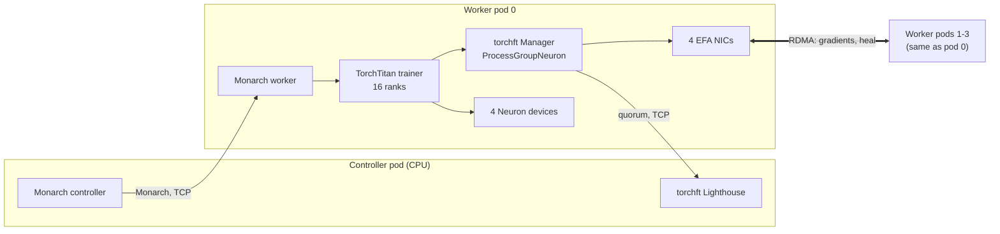

# Component diagram: Monarch + torchft on Trainium

Plain text:

1. Controller pod: Monarch controller and torchft Lighthouse.
2. Four worker pods, all alike. Each has a Monarch worker, the TorchTitan trainer
   (16 ranks), the torchft Manager, 4 Neuron devices and 4 EFA NICs.
3. The controller drives each worker over Monarch (TCP).
4. The torchft Manager asks the Lighthouse for the quorum (TCP).
5. Worker pods exchange gradients, and heal restarted replicas, over EFA RDMA.
